<div align="center">

<br/>

<a href="https://github.com/Gomyeunghan"></a>

<sub>1UP · frontend · ai-native dev · incheon</sub>

<br/><br/>

</div>

```sh
$ whoami
> 화면 너머의 감각을 만드는 사람.

$ cat ./now.txt
> AI랑 페어 프로그래밍하고, 컴포넌트를 쪼개고, 새벽에 커밋함.

$ ls ./likes
> AI 에이전트   다크모드   잘 짜인 구조   쓸데없이 예쁜 인터랙션

$ git log --oneline -1
> a1b2c3d fix: 어제의 나를 고침
```

<br/>

<div align="center">

<sub>━━━━━━━━━━━━  🪙 INSERT COIN  ━━━━━━━━━━━━</sub>

<br/>

<picture>
  <source media="(prefers-color-scheme: dark)" srcset="https://raw.githubusercontent.com/Gomyeunghan/Gomyeunghan/output/pacman-contribution-graph-dark.svg">
  <source media="(prefers-color-scheme: light)" srcset="https://raw.githubusercontent.com/Gomyeunghan/Gomyeunghan/output/pacman-contribution-graph.svg">
  
</picture>

<br/><br/>

<sub>GAME OVER? · <a href="https://galaxy-omega-tawny.vercel.app">CONTINUE ▸ say hi</a> · made with too much coffee ☕</sub>

</div>
